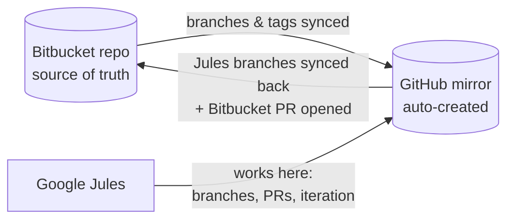

# Jules Bitbucket Connection

Use **[Google Jules](https://jules.google)** with **Bitbucket** repositories.

Jules only connects to GitHub. This bridge works around that: it keeps a
GitHub **mirror** of each Bitbucket repo for Jules to work on, and syncs
Jules' branches straight back to Bitbucket — where it can even open the pull
request for you. No servers to run: everything happens in GitHub Actions
(free if this repo is public — see [the cost note](#limitations--troubleshooting)).



## How it works

A scheduled GitHub Actions workflow in this repo (every 30 minutes by
default, or seconds after each push with the [optional instant
trigger](#optional-instant-sync)) runs a sync engine that enforces a simple
ownership rule per branch:

| Branch | Owner | Sync direction |
|---|---|---|
| Normal branches (`main`, `develop`, feature branches…) | Bitbucket | Bitbucket → GitHub (forced) |
| Jules branches (name ends in a 15–20 digit session id, e.g. `fix-login-bug-1640409954249346636`) | GitHub | GitHub → Bitbucket (forced) |
| Branches that exist only on the GitHub mirror | GitHub | GitHub → Bitbucket |
| Tags | Bitbucket | Bitbucket → GitHub (never forced) |

Deletions are **never** propagated unless you opt in
(`prune_mirror_branches: true`), and committed state files in `state/`
remember where each branch came from, so a branch you delete on one side is
never resurrected by the other.

When Jules publishes a new branch, the bridge copies it to Bitbucket and
(by default) **opens a Bitbucket pull request** that links back to the
GitHub-side PR and stays updated as Jules pushes more commits.

## Quick start

### 1. Get this repo

Click **Use this template** (top right) to create your own copy, e.g.
`your-user/jules-bitbucket-connection`.

> **Public or private?** Public means unlimited free Actions minutes. The
> bridge repo contains only this engine, your config, and sync state — no
> source code — but the config and state do reveal your repo names and
> branch names. Private keeps those hidden and fits inside GitHub's free
> 2,000 minutes/month at the default 30-minute schedule.

### 2. Create two tokens

**Bitbucket — Atlassian API token** (app passwords were retired in July 2026):

1. Go to [id.atlassian.com → Security → API tokens](https://id.atlassian.com/manage-profile/security/api-tokens)
   → **Create API token with scopes** → app **Bitbucket**.
2. Select exactly these scopes:
   `read:repository:bitbucket`, `write:repository:bitbucket`,
   `read:pullrequest:bitbucket`, `write:pullrequest:bitbucket`.
3. Note the expiry you chose (1–365 days) — set a reminder to rotate it.

> **Team alternative:** a Bitbucket **workspace access token** (Workspace
> settings → Access tokens, scopes *Repositories: Write* and *Pull requests:
> Write*) works too, isn't tied to a person, and doesn't force yearly
> rotation. If you use one, skip the `BITBUCKET_EMAIL` secret below.

**GitHub — fine-grained personal access token** (used to create and push the
mirrors):

1. GitHub → Settings → Developer settings → [Fine-grained tokens](https://github.com/settings/personal-access-tokens/new).
2. Resource owner: your user — or, if the mirrors should live in an org,
   pick the org here **and** set `mirror_owner: your-org` in
   `jules-sync.yml` (step 4).
3. Repository access: **All repositories** (required — the token must reach
   mirror repos that don't exist yet).
4. Permissions → Repository permissions:
   - **Contents: Read and write** (push)
   - **Administration: Read and write** (create mirror repos)
   - **Workflows: Read and write** (only needed if your Bitbucket repos
     contain `.github/workflows` files — harmless to grant anyway)

> A classic PAT with `repo` + `workflow` scopes also works.

### 3. Add the secrets

In **your copy** of this repo: Settings → Secrets and variables → Actions →
New repository secret:

| Secret | Value |
|---|---|
| `BITBUCKET_TOKEN` | the Atlassian API token (or workspace access token) |
| `BITBUCKET_EMAIL` | your Atlassian account email — **only** for API tokens; omit for workspace access tokens |
| `MIRROR_GITHUB_PAT` | the GitHub PAT |

### 4. List your repos

Edit [`jules-sync.yml`](jules-sync.yml):

```yaml
repos:
  - bitbucket: myworkspace/my-repo
```

Commit to `main` — that push triggers the first sync, which creates
`my-repo-mirror` on GitHub and fills it with your Bitbucket branches. (Or
run it manually: Actions → *Jules Bitbucket Sync* → Run workflow.)

### 5. Connect Jules to the mirror

In [Jules](https://jules.google), add the new mirror repo
(**+ Add repository** → it opens the *Google Labs Jules* GitHub App
authorization — select the mirror repo). Every future mirror repo needs to
be granted to the Jules app the same way (GitHub → Settings → Applications
→ Google Labs Jules → Configure).

That's it. Give Jules a task on the mirror repo.

## Day-to-day flow

1. **Start a task in Jules** on the mirror repo (its default branch tracks
   your Bitbucket main branch).
2. Jules publishes a branch/PR on the mirror. Within a sync cycle the
   branch appears **in Bitbucket with a pull request already open**.
3. **Want changes?** Comment on the **GitHub** PR — Jules reads and responds
   to PR comments there and pushes fixes; the Bitbucket PR updates
   automatically.
4. **Happy?** Merge the **Bitbucket** PR (that's your source of truth). The
   merged main branch syncs back to the mirror on the next cycle.

> **Rule of thumb:** *write* on Bitbucket, *let Jules write* on GitHub.
> Don't merge PRs on the mirror and don't commit to Jules' branches from
> Bitbucket — each branch has one owner, and the owner's side wins.

## Optional: instant sync

Polling means up to ~30 minutes of latency (GitHub can also delay scheduled
runs). For sync within seconds of every Bitbucket push, add the small
pipeline in [`examples/bitbucket-pipelines.yml`](examples/bitbucket-pipelines.yml)
to your Bitbucket repo — it pings this repo's workflow through GitHub's
`repository_dispatch` API. The scheduled poll keeps running as a safety net
(and it's what picks up Jules' pushes on the GitHub side).

## Configuration reference

All settings live in [`jules-sync.yml`](jules-sync.yml); everything under
`defaults:` can be overridden per repo entry.

| Setting | Default | Meaning |
|---|---|---|
| `mirror_owner` | PAT owner | GitHub user/org that owns the mirrors |
| `mirror_suffix` | `-mirror` | mirror repo name = `<slug><suffix>` |
| `github_repo` (per repo) | — | explicit mirror repo name |
| `private_mirrors` | `true` | create mirrors as private repos |
| `create_bitbucket_prs` | `true` | auto-open a Bitbucket PR for new Jules branches |
| `bitbucket_main_branch` | auto | PR destination branch |
| `prune_mirror_branches` | `false` | propagate Bitbucket branch deletions to the mirror |
| `sync_tags` | `true` | copy tags Bitbucket → GitHub |
| `jules_branch_regex` | `-\d{15,}$` | how Jules branches are recognized |
| `allow_existing` (per repo) | `false` | adopt an existing non-empty GitHub repo as the mirror |

## Safety properties

- **Your Bitbucket repo is never force-pushed** except on branches Jules
  created (and you can review everything in the auto-opened PR first).
- The bridge **refuses to touch an existing GitHub repo** unless it's empty,
  carries the `jules-bitbucket-mirror` topic, or you set `allow_existing`.
- Tokens are passed to git via header config in the environment — they never
  appear in URLs, logs, or process arguments.
- Deletions never propagate by default.

## Limitations & troubleshooting

- **Latency**: without the instant trigger, changes travel on the 30-minute
  poll (GitHub may add delay under load). Jules' own pushes always travel on
  the poll — tighten the cron in
  [`.github/workflows/jules-sync.yml`](.github/workflows/jules-sync.yml) if
  that's too slow for you.
- **Cost**: on a **public** bridge repo, Actions minutes are free and you
  can poll as often as every 5 minutes. On a **private** one, the default
  30-minute schedule uses roughly 1,400 of GitHub's 2,000 free monthly
  minutes — don't tighten the cron there without checking your plan.
- **Merging on the wrong side**: if you merge a PR on the *mirror*, the next
  sync force-resets the mirror's main branch to Bitbucket's version and the
  merge is lost. Merge in Bitbucket.
- **Schedule auto-disable**: GitHub disables schedules in public repos after
  60 days without commits. The workflow self-heals with a keepalive commit,
  but if Actions was off for a long time re-enable it under the Actions tab.
- **Token expiry**: Atlassian API tokens live at most a year; fine-grained
  GitHub PATs also expire. If syncs start failing with 401s, rotate the
  secret.
- **A real branch matches the Jules pattern**: a human branch ending in 15+
  digits would be treated as Jules-owned. Tighten `jules_branch_regex` if
  your team does that.
- **First run fails with "refusing to sync over it"**: the target mirror
  name collides with an existing repo — set `github_repo:` to another name
  or `allow_existing: true` if that repo really is the mirror.
- **Jules can't see the mirror**: you still need to grant the Google Labs
  Jules GitHub App access to each new mirror repo (step 5).

## Contributing

Issues and PRs welcome. The whole engine is one file,
[`scripts/sync.py`](scripts/sync.py) — run `python scripts/sync.py --dry-run`
locally (with the three env vars set) to see the sync plan without touching
anything.

## License

[MIT](LICENSE)
